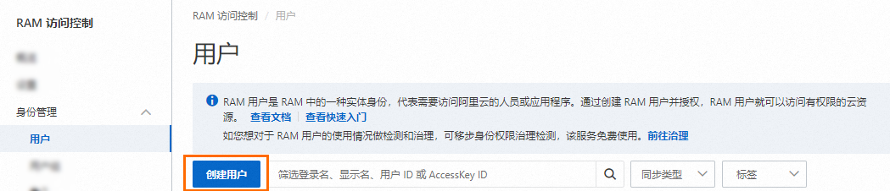
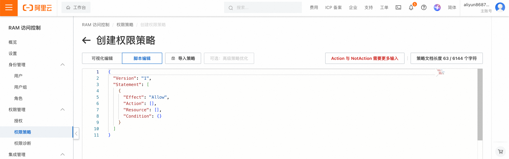
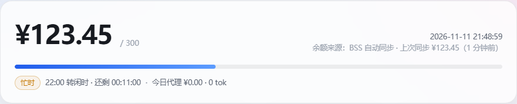

# BailianHUD · 百炼余额浮窗

查看百炼代金券余额、计价时段和本地代理用量。提供 DSH 插件与 ZCode Windows 程序，支持阿里云 BSS 自动同步。

## 下载与安装

适用于 Windows x64，解压即可使用，无需安装 Python。

| 使用方式 | 下载 | 安装后从哪里打开 |
| --- | --- | --- |
| DSH 插件 | [下载插件 ZIP](https://github.com/imYuu-dev/BailianHUD/releases/latest/download/BailianHUD-DSH-windows-x64.zip) | DSH 左栏「更多 → 百炼浮窗」 |
| ZCode 程序 | [下载程序 ZIP](https://github.com/imYuu-dev/BailianHUD/releases/latest/download/BailianHUD-ZCode-windows-x64.zip) | `BailianHUD.exe` 或托盘 |

**DSH**　先打开 DSH，再解压插件 ZIP，双击 `Install.cmd`。在 DSH 插件页点击「刷新」，启用 `dsh-bailian-hud`。

**ZCode**　解压程序 ZIP，双击 `BailianHUD.exe`。保留旁边的 `_internal` 文件夹。

先启动一次，看到浮窗后再继续。首次余额显示「待同步」。

## 获取自己的 AK

AK 包含 **AccessKey ID** 和 **AccessKey Secret**，用于查询代金券。模型调用用的 `sk-` API Key 另行配置。

### 1. 创建 RAM 用户

用代金券所属的阿里云账号登录 RAM 控制台，依次打开「身份管理 → 用户 → 创建用户」。[打开 RAM 控制台](https://ram.console.aliyun.com/)



登录名称可填 `bailian-hud`，访问方式选择「使用永久 AccessKey 访问」，按页面提示确认并完成验证。创建后保存 **AccessKey ID** 和 **AccessKey Secret**。Secret 仅在创建时显示一次，请保存在自己的密码管理器中。[官方创建步骤](https://help.aliyun.com/zh/ram/user-guide/create-a-ram-user)

已有 RAM 用户时，进入该用户的「凭证管理 → AccessKey → 创建 AccessKey」。[官方 AccessKey 说明](https://help.aliyun.com/zh/ram/user-guide/create-an-accesskey-pair)

### 2. 授予代金券查询权限

在 RAM 控制台打开「权限管理 → 权限策略 → 创建权限策略」，选择「脚本编辑」。



将编辑器内容替换为下面的 JSON，保存为 `BailianHUDCouponReadOnly`。

```json
{
  "Version": "1",
  "Statement": [
    {
      "Effect": "Allow",
      "Action": "bss:DescribeCoupons",
      "Resource": "*"
    }
  ]
}
```

回到「身份管理 → 用户」，为 `bailian-hud` 添加权限。授权范围选择「整个云账号」，在「自定义策略」中选中 `BailianHUDCouponReadOnly`，确认授权。

该策略允许查询代金券信息。程序调用 `QueryCashCoupons`，对应的 RAM 权限点为 `bss:DescribeCoupons`。[官方授权信息](https://help.aliyun.com/zh/user-center/developer-reference/api-bssopenapi-2017-12-14-querycashcoupons)

## 导入 AK

### 3. 保存配置文件

**先启动一次对应版本。** 打开文件资源管理器，把对应路径粘贴到地址栏，按回车。

| 所用版本 | 数据目录 |
| --- | --- |
| DSH 插件 | `%USERPROFILE%\.dsh\storages\bailian-hud` |
| ZCode 程序 | `%LOCALAPPDATA%\BailianHUD` |

如果提示「位置不可用」，回到第一步启动对应版本，确认浮窗或插件服务已运行，再打开目录。

将下载包中的 `bss-credentials.example.json` 复制到这个数据目录，重命名为 `bss-credentials.json`。右键选择「打开方式 → 记事本」，替换下面两个值后保存。

```json
{
  "aliyunAkId": "粘贴自己的 AccessKey ID",
  "aliyunAkSecret": "粘贴自己的 AccessKey Secret"
}
```

保留英文双引号和逗号。在资源管理器中打开「查看 → 显示 → 文件扩展名」，确认文件名为 **`bss-credentials.json`**。用记事本另存为时，文件类型选择「所有文件」，编码选择 UTF-8。

### 4. 重启并确认同步

- **DSH**　在「更多 → 百炼浮窗」中点击「退出服务」，再点击「显示浮窗」。
- **ZCode**　在托盘菜单退出程序，再运行 `BailianHUD.exe`。

等待一个同步周期，默认 60 秒。双击浮窗打开监控面板，确认出现余额、「BSS 自动同步」和最近更新时间。



上图截自独立演示实例，金额为示例数据。AK 保存在自己的电脑上，请勿把配置文件、密钥或含密钥的截图上传到 GitHub。

## 日常操作

| 操作 | DSH 插件 | ZCode 程序 |
| --- | --- | --- |
| 点 X 后恢复 | 更多 → 百炼浮窗 → 显示浮窗 | 单击托盘、重新运行 EXE，或 `Ctrl+Alt+B` |
| 打开面板 | 插件菜单或双击浮窗 | 托盘菜单或双击浮窗 |
| 退出 | 插件菜单「退出服务」 | 托盘菜单「退出服务」 |
| 跟随应用 | 默认跟随 DSH | 默认跟随 ZCode |

DSH 插件随宿主启停。ZCode 程序独立运行。浮窗右键可调整跟随、位置、点击穿透和不透明度。

## 常见问题

| 现象 | 处理 |
| --- | --- |
| 数据目录打不开 | 先启动一次对应版本，确认服务正常运行 |
| 一直「待同步」 | 检查文件路径、`.json.txt` 后缀、两个 AK 字段，保存后重启 |
| `AccessDenied` / `Forbidden` | 确认查询策略已授权给创建 AK 的 RAM 用户，授权范围为整个云账号 |
| AK 校验失败 | 检查 ID 与 Secret 是否属于同一组、AK 是否启用，以及系统时间和网络 |
| 未找到券或券不可用 | 确认 AK 属于代金券所在账号，且该券已生效、未过期 |
| 余额有变化，今日代理为零 | 今日代理仅统计经过本地代理的请求，其他渠道消费由 BSS 余额同步反映 |

多张券需要指定时，在数据目录 `.hud_prefs.json` 的 `coupon` 字段填写目标券的 `CashCouponNo` 或 `CashCouponId`，然后重启。更换绑定后等待新券同步。也可在面板中手动校准余额。

<details>
<summary>本地代理与其他配置</summary>

需要记录请求用量时，在客户端配置自己的百炼 API Key，以及对应的 Anthropic 兼容 base URL。

```text
DSH 插件  http://127.0.0.1:18765/apps/anthropic
ZCode 程序  http://127.0.0.1:18766/apps/anthropic
```

端口冲突时自动回退。从监控面板地址栏或数据目录 `.hud_instance.json` 取得实际地址。显式使用 `--port` 时保持固定端口。退出对应服务会停止代理，停用后可将客户端恢复为原有上游地址。

环境变量 `ALIYUN_AK_ID` / `ALIYUN_AK_SECRET`、`ALIBABA_CLOUD_ACCESS_KEY_ID` / `ALIBABA_CLOUD_ACCESS_KEY_SECRET` 优先于文件。兼容 `%USERPROFILE%\.dsh\qwen-coupon.json`，本程序数据目录中的配置文件优先于旧配置。

可选浏览器推送脚本位于 `extras/`。面板中的「打开阿里云卡券页并同步」用于该推送方式。使用 AK 时，程序自动轮询 BSS。

`/api/plugin/balance` 提供只读余额，`remaining` 为数值。无真实余额时返回 `ok: false`、`remaining: null`。`/api/stats` 提供统计，`/api/ping` 检查服务。

价格表与缓存规则用于估算，请以官方账单为准。程序监听 `127.0.0.1`，不保存模型请求正文或客户端 API Key。数据目录中的状态、令牌、流水、日志和凭据文件均应保留在本机。

</details>

<details>
<summary>从源码构建</summary>

需要 Windows x64、Python 3.11、Tk 与 Node.js。

```powershell
python -m pip install -r requirements-build.txt
python -m unittest discover -s tests -p "test_*.py" -v
node tests/test_userscript.js
node --test dsh-plugin/tests/controller.test.mjs
python tools/build_windows.py
python tests/smoke_exe.py dist/BailianHUD/BailianHUD.exe
python tests/smoke_exe.py dist/BailianHUD/BailianHUD.exe --plugin
python tools/package_release.py
```

产物位于 `dist/packages/`，包含插件 ZIP、标准 TGZ、ZCode ZIP、源码 ZIP 与 SHA256 校验值。GitHub Actions 执行相同的测试和构建。

标准插件包也可通过 CLI 安装，并在 DSH 中启用。

```powershell
dsh plugin --profile desktop add /absolute/path/dsh-bailian-hud-0.2.0.tgz
```

</details>

MIT 许可。第三方许可见 `licenses/`。阿里云界面截图取自官方公开文档，来源与原图地址见 [截图来源](docs/images/SOURCES.md)。
